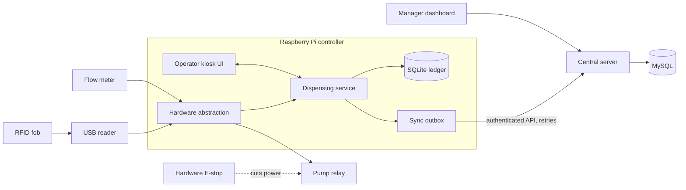

# AgriFlow

AgriFlow lets farm operators and managers authorize and audit diesel dispensing from a central
farm tank in Argentina. An operator presents a farm-issued RFID key fob and selects the machine by
equipment number; the pump controller validates access, enables the pump, measures the delivered
liters and records the session locally, even without internet, then syncs it to a central server.

## Who it is for

- **Operators** refuel at a Raspberry Pi station with a rugged touchscreen, wearing gloves.
- **Managers** review transactions and consumption in an Angular dashboard from a computer or phone.

## Architecture



Two rules hold throughout: the pump is enabled only by a valid local authorization and is disabled
after any fault or restart, and every session has one unique ID so synchronization can repeat safely
without creating duplicates.

## Built with

Node.js and TypeScript, Fastify, SQLite (built-in `node:sqlite`) on the controller, MySQL (Drizzle, mysql2)
centrally, Angular, zod, Biome, Vitest and fast-check, pnpm workspaces.

## Setup

Requires Node 26.13.0 and pnpm 12.16.1 (see `devEngines` in `package.json`).

```
pnpm install
cp .env.example .env
```

## Checks

```
pnpm typecheck
pnpm lint
pnpm test
pnpm check   # all three
```

## Database

The controller uses a local SQLite file (`CONTROLLER_DB_PATH`). The central server uses MySQL
(`DATABASE_URL`). Migration and seed scripts live in `scripts/` and arrive with the server and
controller (see [ROADMAP](ROADMAP.md)).

The MySQL tests are opt-in: set `MYSQL_TEST_URL` to a throwaway database whose name ends in `_test`
(see [ADR 0002](docs/adr/0002-mysql-central.md)). Without it they are skipped and the in-memory
repository tests still run.

## Usage

Development runs on Windows with simulated hardware (`HARDWARE_DRIVER=simulator`). The same
controller code runs on the Raspberry Pi with GPIO and the USB reader. Administration is by CLI
scripts in v1: seed, enroll a fob, issue a device token, back up.

## API

| Method | Path                      | Purpose                                                                    |
| ------ | ------------------------- | -------------------------------------------------------------------------- |
| POST   | `/v1/sync/sessions`       | Controller uploads finalized sessions; returns per-session acknowledgments |
| GET    | `/v1/health`              | Liveness                                                                   |
| GET    | `/v1/transactions`        | Manager: list transactions                                                 |
| GET    | `/v1/machines`            | Manager: list machines                                                     |
| GET    | `/v1/reports/consumption` | Manager: consumption totals                                                |

## Documentation

- [AGENTS.md](AGENTS.md) rules for contributors and coding agents
- [ROADMAP.md](ROADMAP.md) planned work
- [docs/domain.md](docs/domain.md) glossary, rules, reference scenario
- [docs/landscape.md](docs/landscape.md) alternatives
- [docs/adr/](docs/adr/) architecture decisions

## Data policy

Stored: pseudonymous operator IDs, credential references (fob UIDs, hashed), machine IDs,
permissions, tank and device IDs, dispensing measurements, timestamps, sync status and audit events.
Not collected: names, DNI numbers, contact details, biometrics, precise location histories.
Operator-linked identifiers remain potentially personal data; access is restricted. Credentials and
secrets stay out of logs. Retention, backup and deletion policies must be defined before deployment
and must preserve audit integrity.

## Ownership and license

Copyright (c) 2026 David Espinosa. MIT license, see [LICENSE](LICENSE).
