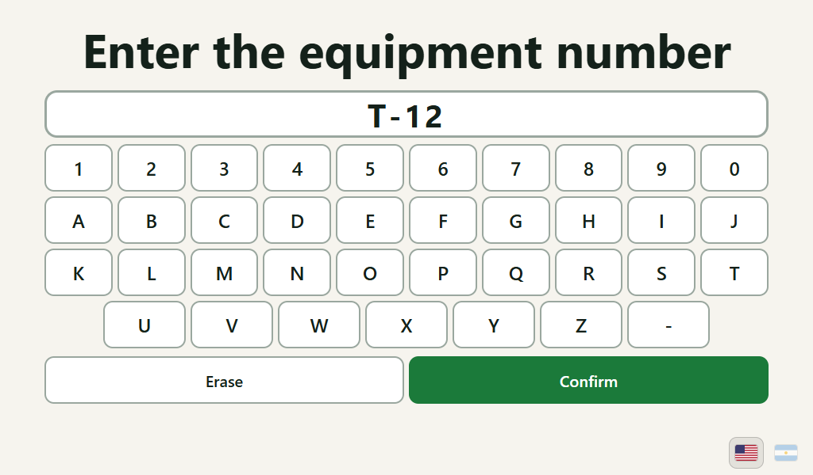
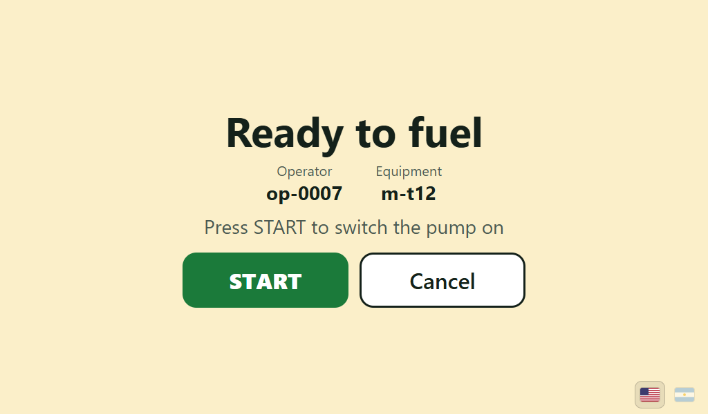
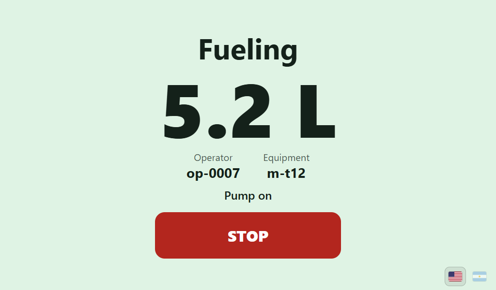
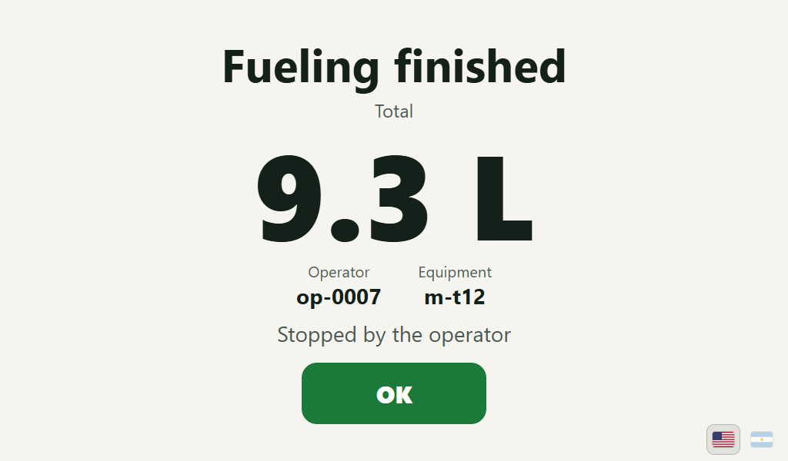
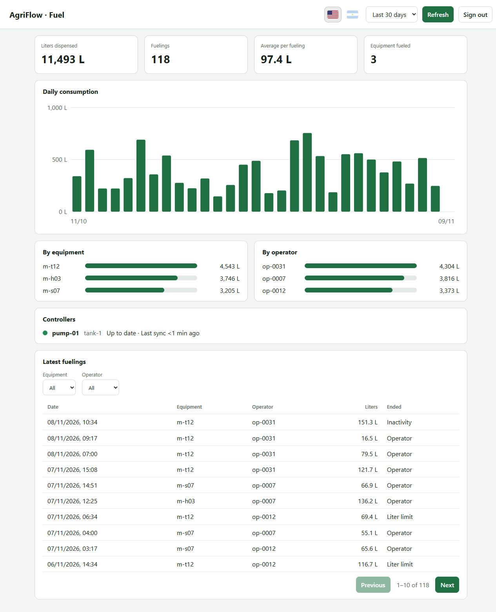
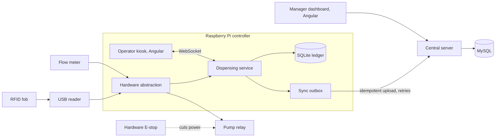

# AgriFlow

AgriFlow lets farm operators and managers authorize and audit diesel dispensing from a central
farm tank in Argentina. An operator presents a farm-issued RFID key fob and selects the machine by
equipment number; the pump controller validates access, enables the pump, measures the delivered
liters and records the session locally, even without internet, then syncs it to a central server.

## Who it is for

- **Operators** refuel at a Raspberry Pi station with a rugged touchscreen, wearing gloves.
- **Managers** review transactions and consumption in an Angular dashboard from a computer or phone.

## Screenshots

Captured from the running system with the simulator and dummy data (`pnpm seed`). The kiosk is
shown at 1024×600, a typical 7 inch touchscreen. The interface is in English by default; the flag buttons (United States, Argentina) switch to Spanish and the choice is remembered. `?lang=es` opens it in Spanish directly.

| Present the fob                                | Enter the equipment                                | Ready                                            |
| ---------------------------------------------- | -------------------------------------------------- | ------------------------------------------------ |
|  |  |  |

| Fueling                                                 | Finished                                               |
| ------------------------------------------------------- | ------------------------------------------------------ |
|  |  |



## Architecture



Two rules hold throughout: the pump is enabled only by a valid local authorization and is disabled
after any fault or restart, and every session has one unique ID so synchronization can repeat safely
without creating duplicates.

## Built with

Node.js and TypeScript, Fastify, SQLite (built-in `node:sqlite`) on the controller, MySQL (Drizzle, mysql2)
centrally, Angular, zod, Biome, Vitest and fast-check, pnpm workspaces.

## Setup

Requires Node 26.13.0 and pnpm 12.16.1 (see `devEngines` in `package.json`).

```
pnpm install
cp .env.example .env
```

## Checks

```
pnpm typecheck
pnpm lint
pnpm test
pnpm check   # all three
```

## Database

The controller uses a local SQLite file (`CONTROLLER_DB_PATH`). The central server uses MySQL
(`DATABASE_URL`). Migration and seed scripts live in `scripts/` and arrive with the server and
controller (see [ROADMAP](ROADMAP.md)).

The MySQL tests are opt-in: set `MYSQL_TEST_URL` to a throwaway database whose name ends in `_test`
(see [ADR 0002](docs/adr/0002-mysql-for-central-records.md)). Without it they are skipped and the in-memory
repository tests still run. `MYSQL_E2E_URL` (a database ending in `_e2e_test`) additionally runs
the offline-outage end-to-end test against MySQL.

## Usage

### Run it on a development machine

Development runs on Windows (or any OS) with simulated hardware. A MySQL instance is needed for the
central server (see [ADR 0002](docs/adr/0002-mysql-for-central-records.md) for a one-line Docker command).

```bash
pnpm install
cp .env.example .env                             # then set FOB_SALT and DATABASE_URL
pnpm migrate                                     # controller (SQLite) and server (MySQL) schemas
pnpm seed --server --history 30                  # demo data; prints one-time demo tokens
pnpm --filter @agriflow/dashboard build          # builds the kiosk and the manager dashboard
node --env-file=.env apps/server/src/main.ts     # server and manager dashboard on :4000
node --env-file=.env apps/controller/src/main.ts # controller and kiosk on :4100
```

Open `http://127.0.0.1:4100` for the kiosk and `http://127.0.0.1:4000` for the manager dashboard
(sign in with the manager token printed by the seed). With the simulator, `POST /dev/scan` with
`{"uid": "04A1B2C3"}` on the controller plays a fob scan; then enter `T-12` on the keypad. Set
`SYNC_SERVER_URL` and `CONTROLLER_DEVICE_TOKEN` to upload sessions to the server.

### Run it on a Raspberry Pi

Set `HARDWARE_DRIVER=gpio` and the `GPIO_*` and `RFID_DEVICE` variables, install libgpiod v2
(`apt install gpiod`) and add the service user to the `input` group. See
[ADR 0005](docs/adr/0005-hardware-abstraction-with-simulators.md) and
[ADR 0006](docs/adr/0006-usb-keyboard-wedge-rfid.md) for the wiring rules. The relay circuit must fail
off in hardware, and the GPIO driver must be bench tested before any real use (see the roadmap).

### Administration

Administration is by CLI scripts in v1.

```bash
pnpm enroll-fob --operator op-0007             # then present the fob; only its salted hash is stored
pnpm issue-token device --id pump-01 --tank tank-1
pnpm issue-token manager --id mgr-1            # tokens are printed once; only hashes are stored
pnpm backup                                    # verified online backup of the controller database
```

## API

Central server (`apps/server`). Manager endpoints need a manager bearer token; the sync endpoint
needs a device token.

| Method | Path                      | Purpose                                                                    |
| ------ | ------------------------- | -------------------------------------------------------------------------- |
| POST   | `/v1/sync/sessions`       | Controller uploads finalized sessions; returns per-session acknowledgments |
| GET    | `/v1/health`              | Liveness                                                                   |
| GET    | `/v1/transactions`        | Manager: transactions, newest first, with filters and paging               |
| GET    | `/v1/reports/consumption` | Manager: liters and sessions by day, machine, operator or device           |
| GET    | `/v1/machines`            | Manager: liters per machine                                                |
| GET    | `/v1/operators`           | Manager: liters per operator                                               |
| GET    | `/v1/devices`             | Manager: controllers with last sync time                                   |

Controller (`apps/controller`), listening on the loopback interface for the kiosk.

| Method | Path         | Purpose                                                                                   |
| ------ | ------------ | ----------------------------------------------------------------------------------------- |
| GET    | `/ws`        | WebSocket: live state to the kiosk; commands `select_machine`, `start`, `stop`, `dismiss` |
| GET    | `/v1/state`  | Current state snapshot                                                                    |
| GET    | `/v1/health` | Liveness                                                                                  |
| POST   | `/dev/scan`  | Simulator only: play a fob scan                                                           |

## Documentation

- [AGENTS.md](AGENTS.md) rules for contributors and coding agents
- [ROADMAP.md](ROADMAP.md) planned work
- [docs/domain.md](docs/domain.md) glossary, rules, reference scenario
- [docs/landscape.md](docs/landscape.md) alternatives
- [docs/adr/](docs/adr/) architecture decisions
- [.github/workflows/ci.yml](.github/workflows/ci.yml) CI: typecheck, lint, tests with MySQL, dashboard build

## Data policy

Stored: pseudonymous operator IDs, credential references (fob UIDs, hashed), machine IDs,
permissions, tank and device IDs, dispensing measurements, timestamps, sync status and audit events.
Not collected: names, DNI numbers, contact details, biometrics, precise location histories.
Operator-linked identifiers remain potentially personal data; access is restricted. Credentials and
secrets stay out of logs. Retention, backup and deletion policies must be defined before deployment
and must preserve audit integrity.

## Ownership

This is a 100% independent, personal side project. It is not related to,
sponsored by, or developed for any employer or client.

## License

Copyright (c) 2026 David Espinosa. MIT license, see [LICENSE](LICENSE).
